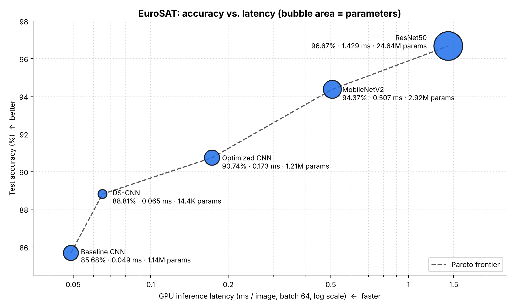
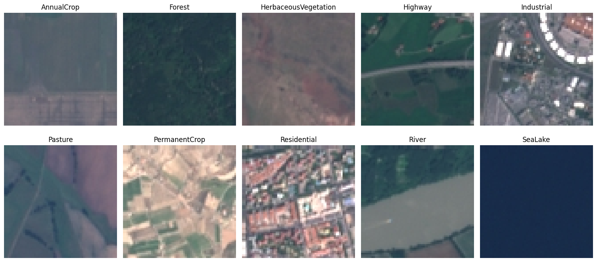
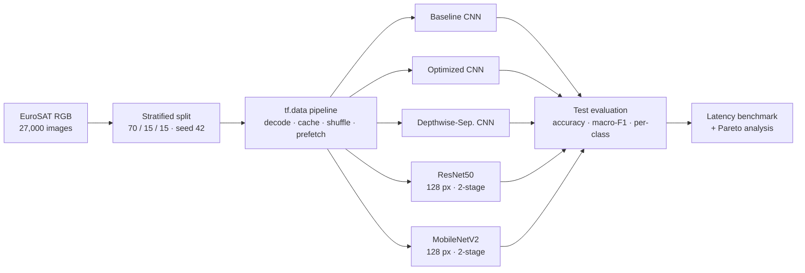
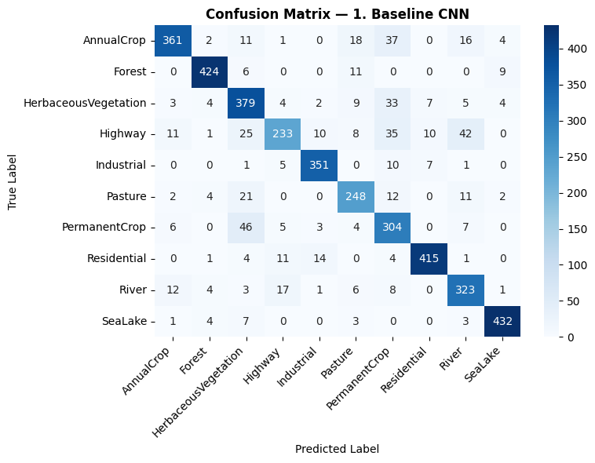
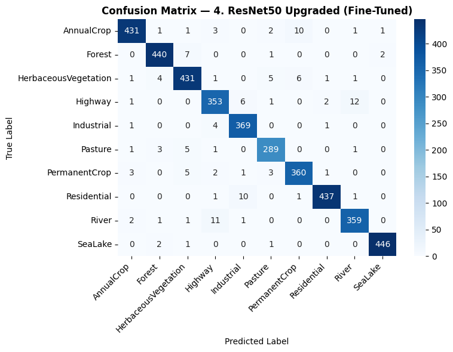
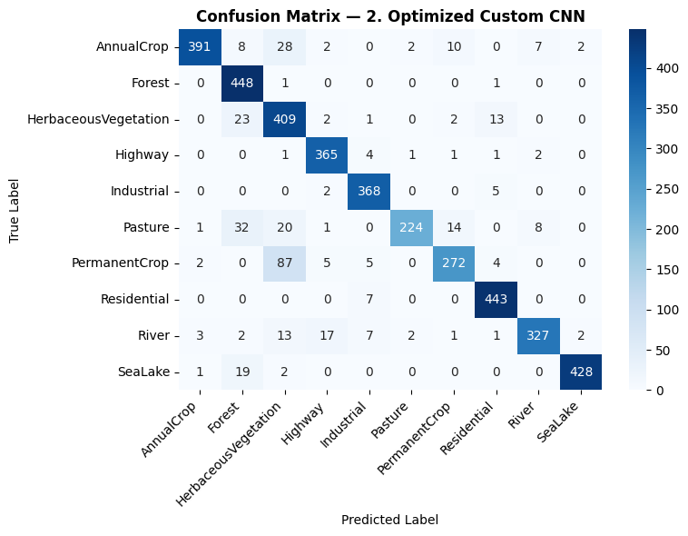
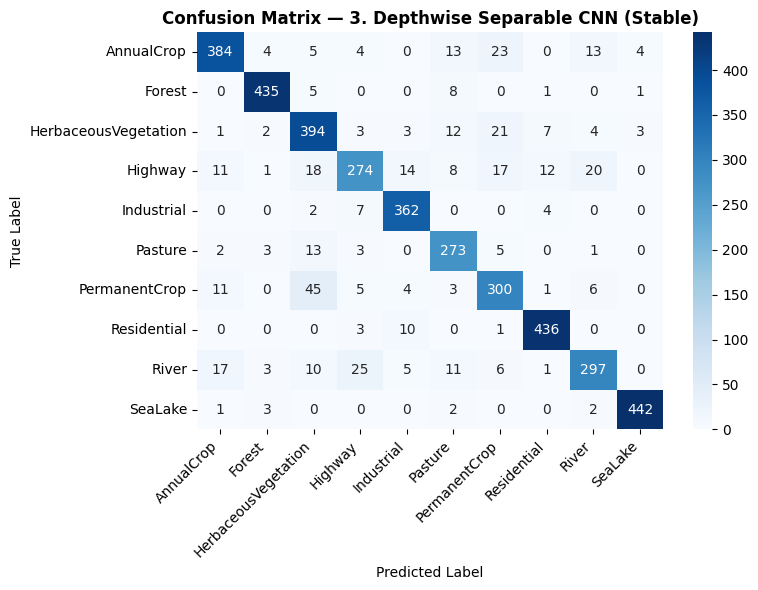
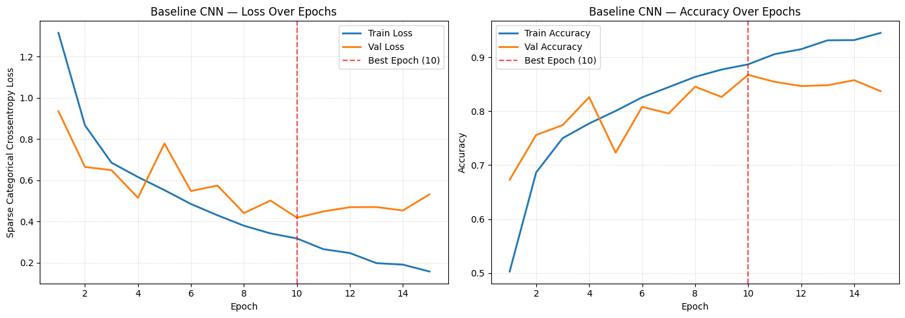

<div align="center">

# 🛰️ EuroSAT Land-Use Classification

### Accuracy vs. efficiency across five CNN architectures, from a 14K-parameter model to a fine-tuned ResNet50


[](https://colab.research.google.com/github/YOUR_USERNAME/YOUR_REPO/blob/main/Satellitefinal.ipynb)



</div>

---

## TL;DR

I trained and benchmarked **five CNN architectures** on **EuroSAT RGB** (27,000 Sentinel-2 satellite patches, 10 land-use classes) using one split, one evaluation protocol and one latency benchmark, then analysed the accuracy / size / speed trade-off.

| 🏆 Highest accuracy | ⚖️ Best accuracy-per-cost (pretrained) | 🪶 Smallest model |
|:---:|:---:|:---:|
| **ResNet50** (fine-tuned)<br>**96.67%** accuracy · 0.966 macro-F1 | **MobileNetV2** (fine-tuned)<br>**94.37%** at 11 MB and 0.51 ms/img | **Depthwise-separable CNN**<br>**88.81%** with only **14,378** parameters |

- **ResNet50 reaches 96.67% test accuracy**, and every one of the 10 classes scores an F1 of at least 0.94.
- **My custom Optimized CNN gains +5.1 points over the baseline for only +5.8% more parameters** (85.68% → 90.74%), using batch norm, progressive dropout, augmentation and a global-average-pooling head.
- **The depthwise-separable CNN is ~80× smaller than the baseline (0.05 MB) yet 3 points more accurate.** It is not faster on a GPU, so its advantage is memory footprint, not speed.
- **All five models lie on the Pareto frontier.** Each step up in accuracy costs more latency, so the right model depends on the deployment target.

---

## Results

All numbers are on the **held-out test set (4,050 images)**. Latency is GPU forward-pass time per image (batch 64, median of 5 passes; protocol below).

| Model | Test accuracy | Macro F1 | Parameters | Size (fp32) | Latency (ms/img) |
|---|:---:|:---:|---:|---:|:---:|
| 1. Baseline CNN | 85.68% | 0.8518 | 1,143,242 | 4.36 MB | 0.049 ± 0.001 |
| 2. Optimized CNN (custom) | 90.74% | 0.9051 | 1,209,322 | 4.61 MB | 0.173 ± 0.001 |
| 3. Depthwise-Separable CNN (custom) | 88.81% | 0.8833 | 14,378 | 0.05 MB | 0.065 ± 0.001 |
| 4. **ResNet50**, fine-tuned (128 px) | **96.67%** | **0.9657** | 24,641,930 | 94.00 MB | 1.429 ± 0.020 |
| 5. MobileNetV2, fine-tuned (128 px) | 94.37% | 0.9421 | 2,918,986 | 11.14 MB | 0.507 ± 0.003 |

> Each model above is a **single training run**, apart from the ResNet50 seed study in [Stability](#stability-multi-seed-test). Treat gaps of a couple of points between the small custom models as indicative, not definitive (see [Limitations](#limitations)).

### Key findings

1. **There is a clean accuracy/latency staircase.** Sorted by latency, accuracy rises at every step (85.7 → 88.8 → 90.7 → 94.4 → 96.7%), so no model is dominated by another.
2. **Architecture beat parameter count for the custom CNNs.** The baseline spends about 92% of its parameters on one `Flatten → Dense(128)` layer (1,048,704 of 1,143,242). The Optimized CNN replaces it with global average pooling and spends that budget on a deeper convolutional stack instead, which is how it gains 5 points with almost the same parameter count. The cost is speed: it runs about 3.5× slower than the baseline on GPU, because it uses two convolutions per block at full resolution.
3. **Pretrained backbones are worth the extra compute.** ResNet50 is +11 points over the baseline and +6 points over the Optimized CNN, at about 20× the parameters and 8× the latency of the Optimized CNN.
4. **MobileNetV2 is the practical middle ground.** Compared with ResNet50 it is 8.4× smaller, 2.8× faster, and 2.3 points less accurate.
5. **Fewer parameters did not mean faster.** The depthwise-separable CNN has 80× fewer parameters than the baseline but is 1.3× slower on GPU (depthwise convolutions use GPU hardware inefficiently). Its benefit is memory, which matters for storage-limited or edge targets; I did not measure on-device latency.

---

## Dataset

[**EuroSAT**](https://github.com/phelber/EuroSAT) (RGB version): 27,000 Sentinel-2 patches at 64×64 pixels, 10 land-use / land-cover classes.



| Split | Images | Share |
|---|---:|:---:|
| Train | 18,900 | 70% |
| Validation | 4,050 | 15% |
| Test | 4,050 | 15% |

The split is **stratified by class with a fixed seed (42)**, so class proportions are identical across splits (for example, Pasture is 1,400 / 300 / 300). The test set is used only for final reporting; early stopping and learning-rate scheduling use validation loss.

---

## Approach



### The five models

| # | Model | Idea | Training recipe |
|---|---|---|---|
| 1 | **Baseline CNN** | 3 conv blocks (32/64/128) → Flatten → Dense(128). Deliberately **no** augmentation, batch norm or dropout, to act as a clean reference. | Adam (1e-3), early stopping (patience 5) |
| 2 | **Optimized CNN** | 4 blocks (32/64/128/256) with **two conv layers per block + BatchNorm**, **progressive dropout** (0.15 → 0.30, 0.40 in the head), **global average pooling**, in-model augmentation. | Adam (1e-3), up to 40 epochs, early stopping (6), LR ×0.5 on plateau |
| 3 | **Depthwise-Separable CNN** | One standard conv, then two `SeparableConv2D` blocks with BatchNorm, GAP and 0.5 dropout. Built to minimise parameters. | Adam (3e-4), early stopping (5), LR ×0.5 on plateau |
| 4 | **ResNet50** (ImageNet) | Frozen backbone first, then the conv5 block is fine-tuned. Input **upscaled to 128×128**. | Stage 1: head only, Adam 1e-3, ≤8 epochs. Stage 2: unfreeze `conv5`, Adam 1e-5, ≤12 epochs |
| 5 | **MobileNetV2** (ImageNet) | Same recipe as ResNet50 for a like-for-like comparison. Last blocks (`block_15`, `block_16`, `out`) unfrozen, **BatchNorm layers kept frozen**. | Stage 1: head only, Adam 1e-3, ≤8 epochs. Stage 2: Adam 1e-5, ≤12 epochs |

### Key technical decisions

| Decision | Why |
|---|---|
| **Upscale 64 → 128 px inside the model** for the pretrained backbones | ImageNet backbones downsample by 32×, so a 64 px input leaves only a **2×2** final feature map. At 128 px it is **4×4**, giving the pretrained features more spatial detail to work with. This was one of several changes (with a larger 512-unit head and conv5 fine-tuning) made between my first frozen 64 px ResNet50 (**93.4%** validation accuracy) and the final model (**about 96.8%** validation accuracy). I did not ablate them individually, so I cannot attribute the gain to upscaling alone. |
| **Two-stage transfer learning** | A new head trained on top of a frozen backbone first avoids wrecking pretrained weights with large early gradients. Then a **very low learning rate (1e-5)** fine-tunes the last block. |
| **Identical recipe for ResNet50 and MobileNetV2** | Same resolution, augmentation, head (Dense 512 + Dropout 0.5) and epoch budget, so the difference between them reflects the backbone, not tuning effort. |
| **Each pretrained model's own preprocessing, inside the model** | Pixels are scaled to [0, 1] in the data pipeline, then rescaled to 0–255 and passed through the backbone's official `preprocess_input` in a `Lambda` layer, so evaluation code never has to remember it. |
| **Flip and rotation augmentation** (in-model, training only) | Overhead imagery has no canonical "up", so flips and rotations are label-preserving. Doing it in the model keeps it off the inference path. The baseline uses none by design. |
| **Early stopping + LR-on-plateau on validation loss, best weights restored** | Prevents the baseline-style overfitting (train accuracy far above validation accuracy) and keeps the test set untouched until the end. |
| **Fast `tf.data` pipeline** | JPEGs are decoded and normalised once, cached in memory, reshuffled every epoch (buffer = full train set), batched at 64 and prefetched. |
| **Latency measured separately from evaluation** | See [Methodology](#methodology--reproducibility). |
| **Model size = fp32 weights (parameters × 4 bytes)** | Excludes optimizer state, so sizes are comparable across models. |

---

## Stability (multi-seed test)

To check that results are not an accident of weight initialisation, I retrained the ResNet50 pipeline with **three seeds (42, 1337, 2026)**.

| Seed | Test accuracy | Macro F1 |
|:---:|:---:|:---:|
| 42 | 94.40% | 0.9414 |
| 1337 | 94.74% | 0.9455 |
| 2026 | 95.16% | 0.9497 |
| **Mean ± sample SD (n = 3)** | **94.77% ± 0.38%** | — |

**95% confidence interval (t-distribution, df = 2): [93.81%, 95.72%].**

What this does and does not show:

- ✅ **Run-to-run variation from initialisation and augmentation randomness is small** (SD 0.38 points). Even the lower end of the interval is well above the best single-run small-CNN result (90.74%).
- ⚠️ These runs use a **shortened protocol** (head-only, 5 epochs, about 3 minutes each, no conv5 fine-tuning), so the mean is about 1.9 points below the full two-stage result (96.67%, single run).
- ⚠️ Seeds change initialisation, dropout and augmentation, but the **data split and shuffle seed stay fixed**, so sensitivity to a different split was not tested.
- ⚠️ With n = 3, the standard deviation itself is a noisy estimate, which is why I report the confidence interval as well.

---

## Per-class analysis

ResNet50 is consistently strong: **every class has F1 ≥ 0.94**, ranging from **0.992 (SeaLake)** to **0.940 (Highway)**. The biggest gains over the baseline are on the classes the baseline struggled with most, which are textured or linear land-cover types:

| Class | Baseline F1 | ResNet50 F1 | Change |
|---|:---:|:---:|:---:|
| Highway | 0.716 | 0.940 | **+0.224** |
| PermanentCrop | 0.743 | 0.957 | **+0.214** |
| HerbaceousVegetation | 0.795 | 0.957 | **+0.161** |
| River | 0.824 | 0.957 | **+0.133** |

The most frequent remaining ResNet50 mistakes are **Highway ↔ River** (12 and 11 images respectively, out of 375 per class), which plausibly reflects two long, thin structures that look alike from above, and **Residential → Industrial** (10 images) and **AnnualCrop → PermanentCrop** (10 images).

<table>
<tr>
<td align="center"><b>Baseline CNN</b><br></td>
<td align="center"><b>ResNet50 (fine-tuned)</b><br></td>
</tr>
</table>

<details>
<summary><b>Full per-class F1 table (all five models)</b></summary>

| Class | Baseline | Optimized | DS-CNN | ResNet50 | MobileNetV2 |
|---|:---:|:---:|:---:|:---:|:---:|
| AnnualCrop | 0.853 | 0.922 | 0.876 | 0.969 | 0.946 |
| Forest | 0.949 | 0.912 | 0.966 | 0.977 | 0.961 |
| HerbaceousVegetation | 0.795 | 0.809 | 0.837 | 0.957 | 0.926 |
| Highway | 0.716 | 0.949 | 0.784 | 0.940 | 0.892 |
| Industrial | 0.929 | 0.960 | 0.937 | 0.969 | 0.966 |
| Pasture | 0.817 | 0.847 | 0.867 | 0.960 | 0.938 |
| PermanentCrop | 0.743 | 0.806 | 0.802 | 0.957 | 0.922 |
| Residential | 0.934 | 0.965 | 0.956 | 0.980 | 0.980 |
| River | 0.824 | 0.910 | 0.827 | 0.957 | 0.910 |
| SeaLake | 0.958 | 0.971 | 0.982 | 0.992 | 0.980 |

</details>

<details>
<summary><b>Confusion matrices for the other three models</b></summary>

 


</details>

<details>
<summary><b>Baseline training curves (overfitting example)</b></summary>



Training accuracy keeps climbing while validation accuracy plateaus around epoch 10, a classic overfitting pattern that the Optimized CNN's batch norm, dropout, augmentation and GAP head are designed to address.

</details>

---

## Methodology & reproducibility

**Latency benchmark** (separate from the accuracy evaluation, so data loading and `predict()` overhead are not counted):

- Forward pass only, in inference mode, on **pre-cached test batches** (batch size 64, 4,050 images).
- Wrapped in `tf.function`, with 3 warm-up batches (plus the smaller final batch) before timing.
- **Median of 5 full passes** on a single Google Colab GPU, reported as mean ms per image ± SD across passes.
- These are **GPU throughput numbers at batch 64, not single-image or on-device latency.**

**Seeds and determinism.** Seeds are set with `tf.keras.utils.set_random_seed`. GPU kernels are not bit-wise deterministic, so reruns can differ by a small margin. Everything in the tables above comes from one notebook run.

**Run it yourself**

1. Download the EuroSAT RGB archive from the [official repository](https://github.com/phelber/EuroSAT) (`EuroSAT_RGB.zip`).
2. Open the notebook in Colab (badge at the top), switch to a GPU runtime, and upload the zip to `/content/EuroSAT_RGB.zip`.
3. Run all cells. The full notebook takes roughly an hour on a Colab GPU.

For local use: `pip install -r requirements.txt`, then point `zip_path` / `dataset_path` in the first cells at your copy of the data.

---

## Limitations

I would rather state these than have them found:

- **Single runs for four of the five models.** Across my development reruns, the same architecture landed in a noticeable range: Optimized CNN 90.7–93.5%, Baseline 85.6–87.5%, and the depthwise-separable CNN **71.7–88.8%** (its training settings were also being tuned between runs). Comparisons among the three small custom CNNs are therefore indicative only.
- **Multi-seed evidence covers only the shortened ResNet50 pipeline**, not every model, and not the full two-stage run.
- **One fixed data split**, so no estimate of split-to-split variance.
- **Several models were still improving when training stopped.** The DS-CNN's best epoch was 38 of a 40-epoch cap, and the ResNet50 and MobileNetV2 fine-tuning stages both peaked at epoch 12 of 12. Longer schedules would probably raise their numbers slightly.
- **Latency is GPU batch-64 throughput.** I did not test CPU, mobile or microcontroller deployment, so the "edge" benefit of the smallest model is about memory footprint, not measured speed.
- **Not a state-of-the-art claim.** Published EuroSAT results with more tuning and stronger backbones are higher than 96.67%. This project is about a controlled comparison and the trade-offs, not a leaderboard entry.

## Future work

- Repeat the **full pipeline with multiple seeds and k-fold splits** for every model, and report mean ± SD throughout.
- Export to **TFLite / ONNX with quantisation** and measure real CPU and mobile latency, where the DS-CNN's size advantage should matter.
- Try stronger, efficiency-oriented backbones (EfficientNet, ConvNeXt) and a **longer fine-tuning schedule**.
- Individually **ablate** the upscaling, head size and unfreezing depth.
- Add **Grad-CAM** to inspect what the models attend to on the hard classes (Highway, River, PermanentCrop), and test on the **13-band multispectral** EuroSAT variant.

---

## Skills demonstrated

Deep learning with TensorFlow/Keras · custom CNN design (BatchNorm, dropout, GAP, depthwise-separable convolutions) · transfer learning and staged fine-tuning · data pipelines with `tf.data` · rigorous evaluation (stratified splits, macro-F1, per-class analysis, confusion matrices) · benchmarking methodology and Pareto trade-off analysis · basic statistics (sample SD, t-based confidence intervals) · honest reporting of limitations.

---

## Repository structure

```
.
├── Satellitefinal.ipynb      # full pipeline: data, models, evaluation, benchmark, seed study
├── requirements.txt
├── README.md
└── assets/                   # figures used in this README
    ├── pareto.png
    ├── sample_grid.png
    ├── baseline_training_curves.png
    └── cm_*.png              # confusion matrices (one per model)
```

## Citation & credits

Dataset: P. Helber, B. Bischke, A. Dengel, D. Borth. *EuroSAT: A Novel Dataset and Deep Learning Benchmark for Land Use and Land Cover Classification.* IEEE Journal of Selected Topics in Applied Earth Observations and Remote Sensing, 2019.

```bibtex
@article{helber2019eurosat,
  title   = {EuroSAT: A Novel Dataset and Deep Learning Benchmark for Land Use and Land Cover Classification},
  author  = {Helber, Patrick and Bischke, Benjamin and Dengel, Andreas and Borth, Damian},
  journal = {IEEE Journal of Selected Topics in Applied Earth Observations and Remote Sensing},
  year    = {2019}
}
```

Pretrained ResNet50 and MobileNetV2 weights come from Keras Applications (ImageNet).

## Contact

**[Your Name]** · [LinkedIn](https://www.linkedin.com/in/YOUR_PROFILE) · [GitHub](https://github.com/YOUR_USERNAME)

If you found this useful, a ⭐ on the repo is appreciated.
